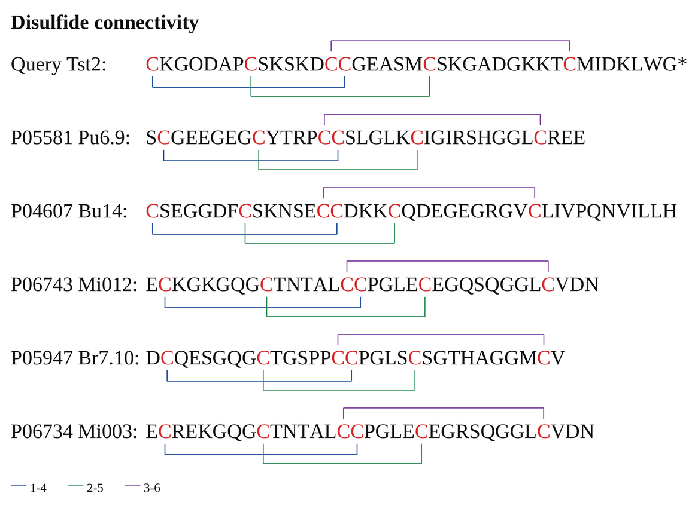

<p align="center">
  
</p>

<p align="center">
  
</p>

<p align="center">
  <a href="README.md">中文</a> · <a href="README.en.md">English</a>
</p>

# disulfide-plot

Plot disulfide connectivity of peptide sequences as colored brackets: sequence in a row, cysteines in red, one colored bracket per bond.

## Preview



## Features

- Pure Pillow; no matplotlib, tkinter or cairo
- Longest-spanning bonds are placed on the top track
- Multiple bonds are split across tracks, with no overlap and no text collision
- Cysteines in red, each bond in a distinct color
- PNG output, optional SVG
- CSV input, or read BLAST outfmt 6 TSV + library FASTA directly

## Install

```bash
pip install -r requirements.txt
```

Requires Pillow (`Pillow>=9.0`). The default font is Liberation Serif; override with `--font` / `--bold`.

## Usage

### 1. Built-in demo (two sequences)

```bash
python3 disulfide_plot.py --demo --out demo.png
```

### 2. From CSV

```bash
python3 disulfide_plot.py -i examples/candidates.csv \
  -o candidates.png --title "1-4 / 2-5 / 3-6 connectivity"
```

Also write an SVG:

```bash
python3 disulfide_plot.py -i examples/candidates.csv \
  -o candidates.png --svg candidates.svg
```

### 3. From BLAST output

```bash
python3 disulfide_plot.py \
  --blast /path/to/blast_short.tsv \
  --fasta /path/to/library.fasta \
  --top 20 --cys 6 -o blast_top20.png
```

Row labels look like `u24304 (80.0%/26%)`, where the values are pident and qcovhsp.
Only subjects with exactly `--cys` cysteines are kept, sorted by `(pident, bitscore)`.

## CSV format

```csv
name,sequence,pairs,note
Query,CKGODAPCSKSKDCCGEASMCSKGADGKKTCMIDKLWG*,1-4;2-5;3-6,query
Pu6.9,SCGEEGEGCYTRPCCSLGLKCIGIRSHGGLCREE,1-4;2-5;3-6,
```

- `sequence` is required; `name`, `pairs`, `note` are optional
- `pairs` uses 1-based cysteine order, e.g. `1-4;2-5;3-6` or `1-4,2-5,3-6`
- Without `pairs`: six cysteines default to `1-4,2-5,3-6`; other counts default to outer-to-inner pairing
- `*`, `O`, `X` are rendered as-is
- Rows with fewer than two cysteines are skipped with `[skip]`

## Options

| Option | Description |
|---|---|
| `-i, --input` | Input CSV |
| `--blast` | BLAST outfmt 6 TSV (15 columns) |
| `--fasta` | Library FASTA for `--blast` |
| `--top` | Keep top N BLAST hits, default 20 |
| `--cys` | Keep subjects with N cysteines, default 6 |
| `--pairs` | Override pairing, e.g. `1-4;2-5;3-6` |
| `-o, --out` | Output PNG, default `disulfide.png` |
| `--svg` | Also write SVG |
| `--title` | Figure title |
| `--font-size` | Font size, default 34 |
| `--gap` | Track spacing, default 15 |
| `--tick` | Extra tick length, default 5 |
| `--row-pad` | Row padding, default 14 |
| `--scale` | Supersampling factor, default 3 |
| `--no-legend` | Hide legend |
| `--font` / `--bold` | Font file overrides |

## Drawing rules

1. Bonds are sorted by span `|j-i|`; the widest goes on `above` track 0
2. Remaining bonds fill `below0 → below1 → above1 → above2 → below2 …`
3. Ticks reach only the text edge, never through the sequence
4. Cysteines use `#d62728`; other residues `#111111`
5. Bond colors follow pairing order: blue / green / purple / orange / teal / magenta

## BLAST mode

- Reads outfmt 6 columns 2 `sseqid`, 3 `pident`, 12 `bitscore`, 15 `qcovhsp`
- `pident` is local HSP identity, not full-length identity
- `qcovhsp` is query coverage, not subject coverage
- For repeated `sseqid`, the best `(pident, bitscore)` hit is kept

## Limitations

- Sequence alone does not encode disulfide pairing; the figure follows `pairs`, and inferred pairing is not experimental proof
- BLAST hits are often 8–10 aa HSPs, while the figure draws the full subject's cysteine pairing
- `blastp-short` pident may be overestimated by about 1.7 percentage points

## Layout

```
disulfide-plot/
├── disulfide_plot.py
├── README.md
├── README.en.md
├── requirements.txt
├── assets/
│   ├── logo.svg
│   └── wordmark.svg
└── examples/
    ├── candidates.csv
    ├── candidates.png
    ├── candidates.svg
    ├── blast_top12.png
    └── demo.png
```

## FAQ

**Font not found**: the default is Liberation Serif. Check with `fc-list | grep -i liberation`, or pass `--font`.

**Chinese title renders as boxes**: use a CJK font such as Noto Sans CJK.

**Too few cysteines**: pairing indices cannot exceed the cysteine count; otherwise you get `pairing 3-6 exceeds 4 cysteines`.

**Figure too wide**: lower `--font-size` or `--scale`; sequences are not wrapped.

## License

MIT
