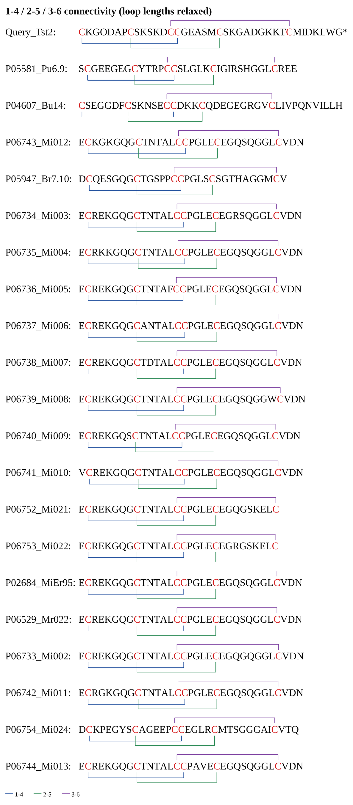
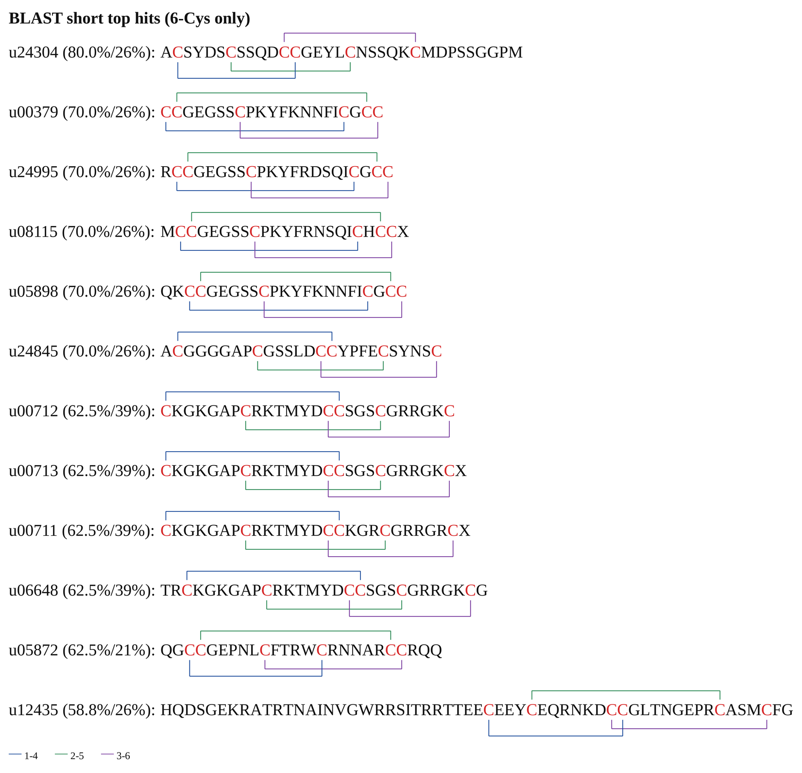

# disulfide_plot.py — 肽序列二硫键连接图

把肽序列的二硫键连接画成彩色括号图，仿 DeepCono/pic 风格：序列横排、Cys 标红、每条键一条彩色括号。

## 效果预览





## 特性

- 纯 Pillow 实现，不需要 matplotlib，也不需要 tkinter / cairo
- 跨度大的键自动放上层，读图时先看到最外层连接
- 多条键分上下轨道排布，不重叠、不压字
- Cys 字母红色，不同键用不同颜色区分
- 支持 PNG 输出，可选同时输出 SVG（可在 Illustrator / Inkscape 里改）
- 支持 CSV 输入，也支持直接读 BLAST outfmt 6 TSV + 库 FASTA

## 安装

```bash
pip install -r requirements.txt
```

只需要 Pillow（`Pillow>=9.0`）。系统里需要有 Liberation Serif 字体，路径
`/usr/share/fonts/truetype/liberation/LiberationSerif-Regular.ttf`；换字体用 `--font` / `--bold`。

## 用法一：内置示例

```bash
cd /data/work/cd/project/tools
python3 disulfide_plot.py --demo --out /tmp/opencode/demo.png
```

输出 `[ok] /tmp/opencode/demo.png  1166x810 px`，画 6 条内置序列（1 条 query + 5 条候选），
每行一条，配对默认 `1-4;2-5;3-6`。

## 用法二：从 CSV 画

```bash
cd /data/work/cd/project/tools
python3 disulfide_plot.py -i examples/candidates.csv \
  -o /tmp/opencode/candidates.png \
  --title "1-4 / 2-5 / 3-6 connectivity"
```

输出 `[ok] /tmp/opencode/candidates.png  1186x2655 px`。20 条记录逐行堆叠，行距按每行
实际需要的上下轨道数自动增长。要同时出 SVG：

```bash
python3 disulfide_plot.py -i examples/candidates.csv \
  -o /tmp/opencode/candidates.png --svg /tmp/opencode/candidates.svg
```

## 用法三：直接从 BLAST 结果画

```bash
cd /data/work/cd/project/tools
python3 disulfide_plot.py \
  --blast /tmp/opencode/conolaxy/c006/short_relaxed.tsv \
  --fasta /tmp/opencode/conolaxy/c004/all_unique.fasta \
  --top 20 --cys 6 \
  -o /tmp/opencode/blast_top20.png
```

输出 `[ok] /tmp/opencode/blast_top20.png`，行标签形如 `u24304 (80.0%/26%)`，
括号内依次是 pident 和 qcovhsp。只保留 Cys 数等于 `--cys` 的序列，按
`(pident, bitscore)` 降序取前 `--top` 条。

## CSV 格式

```csv
name,sequence,pairs,note
Query_Tst2,CKGODAPCSKSKDCCGEASMCSKGADGKKTCMIDKLWG*,1-4;2-5;3-6,query
P05581_Pu6.9,SCGEEGEGCYTRPCCSLGLKCIGIRSHGGLCREE,1-4;2-5;3-6,dist=1
```

- 表头必须含 `sequence` 列；`name`、`pairs`、`note` 可选（也接受 `id` / `header`、
  `disulfides` / `ss`、`source` 这些别名，大小写与首尾空格自动忽略）
- `pairs` 按 Cys 在序列中出现的顺序编号，**1-based**，可写 `1-4;2-5;3-6` 或
  `1-4,2-5,3-6`（分隔符 `;`、`,`、`|` 均可）
- 省略 `pairs` 时：6 个 Cys 默认 `1-4,2-5,3-6`；其他 Cys 数默认首尾配对
  `1-N, 2-(N-1), …`
- `sequence` 可含 `*`、`O`、`X` 等非标准字符，绘图原样显示
- Cys 少于 2 个的行会被跳过并打印 `[skip] 第 N 行 ...: Cys < 2`

## 参数表

| 参数 | 说明 |
|---|---|
| `-i, --input` | 输入 CSV 路径 |
| `--blast` | BLAST outfmt 6 TSV 路径（需 15 列） |
| `--fasta` | 与 `--blast` 配套的库 FASTA |
| `--top` | `--blast` 时取前 N 条，默认 20 |
| `--cys` | `--blast` 时只保留 N 个 Cys 的序列，默认 6 |
| `--pairs` | 配对覆盖，如 `1-4;2-5;3-6`；不给则用默认规则 |
| `-o, --out` | 输出 PNG 路径，默认 `disulfide.png` |
| `--svg` | 同时输出 SVG 到指定路径 |
| `--title` | 图顶部标题 |
| `--font-size` | 正文字号，默认 34 |
| `--gap` | 相邻轨道垂直间距，默认 15 |
| `--tick` | 括号竖线的额外长度，默认 5 |
| `--row-pad` | 行与行之间的留白，默认 14 |
| `--scale` | 超采样倍数，默认 3；越大越清晰、文件越大 |
| `--no-legend` | 不画底部配对图例 |
| `--font` / `--bold` | 替换正文 / 粗体字体文件路径 |

## 画法规则

1. 同一行内所有键按端点跨度 `|j-i|` 降序排列，跨度最大的一条约在 `above` track 0
   （最上层）；跨度相同则右端点更靠后的优先。
2. 其余键依次占用 `below0 → below1 → above1 → above2 → below2 …`，因此同侧相邻
   轨道不会画出交叉重叠的横线。
3. 括号竖线只延伸到文字的上缘 / 下缘，不穿过序列本身。
4. Cys 字母用红色 `#d62728`，其余字母用 `#111111`；键的颜色按 CSV 中 `pairs` 的
   书写顺序循环取 蓝 `#1f4e9c` / 绿 `#2e8b57` / 紫 `#7b3fa0` / 橙 `#d2691e` /
   青 `#008b8b` / 洋红 `#c71585`。
5. 多条序列按行堆叠，每行的上下留白由该行实际轨道数决定，所以键多的行会更高。

## BLAST 模式说明

- 读 outfmt 6 的 15 列格式，取第 2 列 `sseqid`、第 3 列 `pident`、第 12 列
  `bitscore`、第 15 列 `qcovhsp`；列数不足 15 的行直接跳过
- `pident` 是 HSP 局部比对的一致性，不是全长 identity
- `qcovhsp` 是 query 在该 HSP 上的覆盖度，不是 subject 覆盖度
- 只保留 Cys 数恰好等于 `--cys` 的 subject 序列（默认 6），其余过滤掉
- 同一 `sseqid` 多次命中时保留 `(pident, bitscore)` 最大的一条，再按该键排序取前 N

## 重要限制

- 序列本身不编码二硫键配对。图完全按 `pairs` 画，配对是推断值时不代表实验验证。
- BLAST 命中常常只是 8–10 aa 的 HSP，图中画的却是**整条 subject** 的全部 Cys 配对，
  图的连接关系不描述 HSP 区间内的真实结构。
- `blastp-short` 的 pident 相对全长比对可能高估约 1.7 个百分点，读数值时留意。

## 文件结构

```
tools/
├── disulfide_plot.py    主脚本（单文件，无第三方依赖除 Pillow）
├── README.md            本文件
├── requirements.txt     Pillow>=9.0
└── examples/
    ├── candidates.csv   20 条 6-Cys 候选（1-4;2-5;3-6）
    ├── candidates.png   对应 PNG
    ├── candidates.svg   对应 SVG
    ├── blast_top12.png  BLAST short top12 示例
    └── demo.png         --demo 输出
```

## 常见问题

**报错找不到字体**：默认用 Liberation Serif。用 `fc-list | grep -i liberation` 确认路径，
或 `--font /path/to/font.ttf --bold /path/to/bold.ttf` 指到系统里已有的字体。

**中文标题显示成方块**：Liberation Serif 无中文字形。改用一个含中文的字体，例如
`--font /usr/share/fonts/truetype/dejavu/DejaVuSans.ttf`（仍无中文时换 Noto Sans CJK）。

**Cys 数不足 / 图里键太少**：`pairs` 的编号上限是序列中 Cys 的个数，超出会报
`配对 3-6 超出 Cys 数 4`。先用 `grep -o C | wc -l` 核对，或改 `--pairs`。

**图太宽**：调小 `--font-size`（例如 24）或减小 `--scale`（例如 2）。宽度由最长序列
决定，序列本身不会换行。

## 来源 / 版本

- 版本：2026-10-30，内部工具，随 Conolaxy 项目维护
- 参考图：`DeepCono/pic/微信图片_20261029160244_78_151.png`
- 脚本位置：`/data/work/cd/project/tools/disulfide_plot.py`
